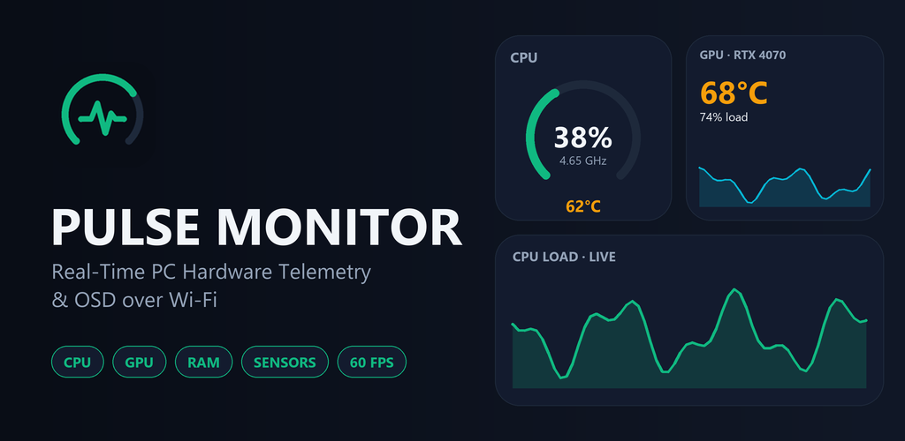
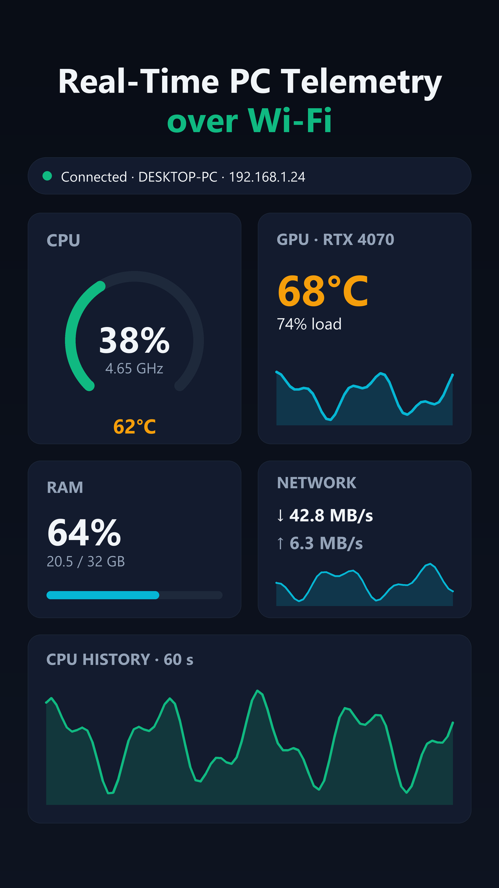
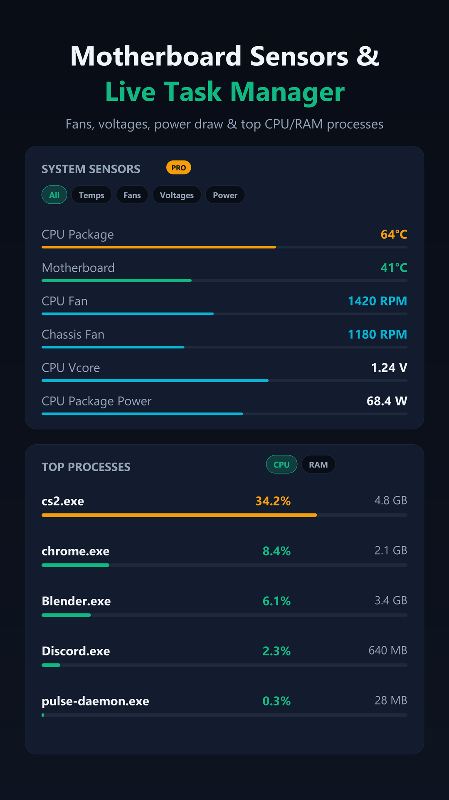
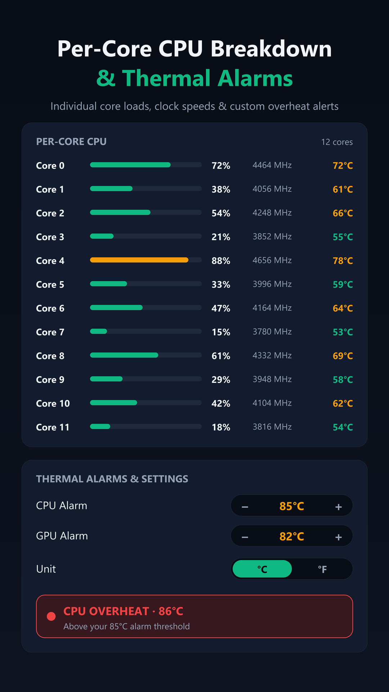
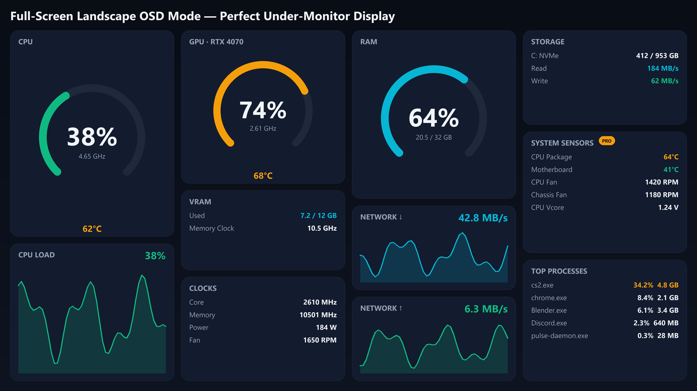

<div align="center">


# Pulse Monitor

**Real-time PC hardware telemetry on your Android phone or tablet, over your own Wi-Fi.**

CPU · GPU · RAM · storage · network · fans · voltages · power — live, every half second.

[](https://github.com/bakball/pulse-monitor-releases/releases/latest)
[](https://play.google.com/store/apps/details?id=com.pulsemonitor)



</div>

---

## What is Pulse Monitor?

Pulse Monitor turns an old phone or tablet into a dedicated hardware dashboard for your PC.
It has two parts:

| Part | What it does | Where to get it |
|------|--------------|-----------------|
| **PC Server** (this repository) | A small background app for Windows and macOS that reads your hardware sensors and streams them over your local network. | [Latest release](https://github.com/bakball/pulse-monitor-releases/releases/latest) |
| **Android app** | Finds your PC automatically and shows everything as a fast, dark, OLED-friendly dashboard. | [Google Play](https://play.google.com/store/apps/details?id=com.pulsemonitor) |

Everything stays on your **local network**. Nothing is sent to the internet, and no account is needed.

## Screenshots

<p align="center">
  
  
  
</p>

<p align="center">
  
</p>

<sub>Preview images; the values shown are sample data.</sub>

## Features

- **Live dashboard** — CPU, GPU, memory, storage and network in a 2-column Bento grid with radial gauges and 60-second sparklines.
- **Desk OSD mode** — turn the device to landscape for a full-screen, 4-column, no-scroll dashboard that keeps the screen on. Made to sit under your monitor.
- **Per-core CPU view** — load, clock and temperature for every core.
- **System sensors** — temperatures, fans, voltages, power, clocks and load, grouped by hardware, with filters.
- **Top processes** — see what is using your CPU and RAM right now.
- **Thermal alarms** — set your own CPU and GPU overheat thresholds, switch between °C and °F.
- **Automatic discovery** — the app finds your PC on the network; you can also connect by IP address.
- **Honest data** — if a sensor can't be read on your hardware, Pulse Monitor shows `--`. It never estimates or makes up temperatures, clocks or wattage.
- **Free and PRO** — core monitoring is free; PRO adds the detailed system sensors and process list.

## Download and install (Windows)

1. Open the **[latest release](https://github.com/bakball/pulse-monitor-releases/releases/latest)** and download **`PulseMonitor-Setup-*.exe`**.
2. Run it and accept the administrator prompt. Sensor access needs administrator rights.
3. Leave the options you want ticked:
   - *Start Pulse Monitor automatically when I sign in* — runs hidden in the tray, no console window, no prompt at login.
   - *Install the PawnIO driver* — lets the server read **CPU temperature, power and voltage** on many processors. It is skipped if PawnIO is already installed.
4. Finish the setup. A pulse icon appears in the system tray.
5. Install the **[Android app](https://play.google.com/store/apps/details?id=com.pulsemonitor)**, make sure the phone is on the **same Wi-Fi / LAN** as the PC, and tap your PC in the list.

**Requirements:** Windows 10 or 11 (64-bit), administrator rights, a phone or tablet on the same network.

### macOS

Download `PulseMonitor-macOS.zip` from the [latest release](https://github.com/bakball/pulse-monitor-releases/releases/latest) and run the server from the extracted folder. Available sensors depend on your Mac.

## Troubleshooting

**The app can't find my PC.**
Both devices must be on the same network. Allow the server through the firewall — it uses **TCP 8765** (telemetry) and **UDP 45454** (discovery). You can also type the PC's IP address in the app. Guest and "client isolation" Wi-Fi networks block device-to-device traffic.

**CPU temperature or power shows `--`.**
That sensor isn't available without the PawnIO driver on most CPUs. Re-run the setup and tick *Install the PawnIO driver*, then restart Pulse Monitor. Some processors don't expose a power sensor at all; in that case `--` is the correct answer.

**I play games with an anti-cheat (FACEIT, Vanguard, Easy Anti-Cheat, BattlEye).**
While one of them is running, Pulse Monitor stops using the kernel driver and falls back to user-mode sensors only, so CPU temperature and power may show `--` during the game.

**Collecting diagnostics for a bug report.**
Run, from an administrator PowerShell:

```powershell
Start-Process -Wait -FilePath "C:\Program Files\PulseMonitor\pulse-daemon.exe" -ArgumentList '--once','--out','C:\pulse-frame.json'
```

This writes the telemetry frame, the raw sensor tree and the sensor-engine state next to `C:\pulse-frame.json`. Open an [issue](https://github.com/bakball/pulse-monitor-releases/issues) and attach them.

## Privacy

Telemetry is sent only between your PC and your own device over your local network. Pulse Monitor does not collect, store or upload personal data or hardware readings to any server. The Android app uses the network permission for local connections and Google Play Billing for the optional PRO subscription.

## Credits

Hardware sensor access is powered by [LibreHardwareMonitor](https://github.com/LibreHardwareMonitor/LibreHardwareMonitor) (MPL-2.0). The optional CPU driver is [PawnIO](https://pawnio.eu/) by namazso.

---

<div align="center">

Made by **ForgeBit Labs**

</div>
